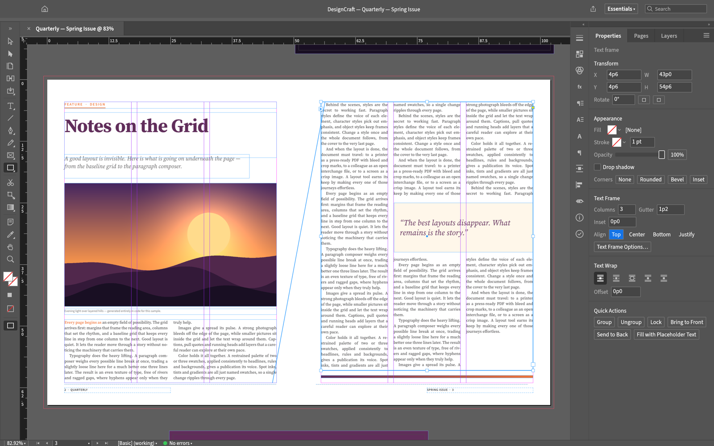
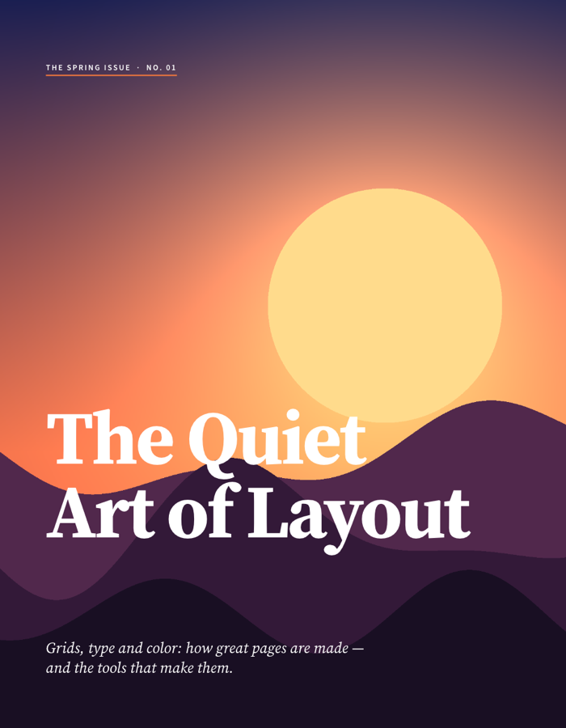
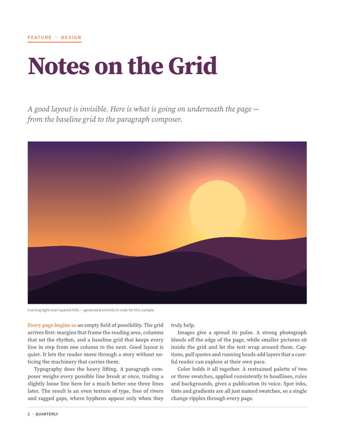

<p align="center">
  <a href="https://workflowind.agcunae.com/apps/">
    <picture>
      <source media="(prefers-color-scheme: dark)" srcset="docs/brand/novafoods-logo-white.svg">
      
    </picture>
  </a>
</p>


<h1 align="center">Nova Design</h1>

<p align="center">
  <b>Page layout and publishing; an open-source, clean-room reimplementation of Adobe InDesign, rebuilt in pure Rust.</b>
</p>

<p align="center">
  A fast, open-source, clean-room take on the Adobe InDesign workflow. It runs natively on macOS,
  Windows and Linux, and in the browser via WebAssembly.<br>
  <i>By the Nova Foods team.</i>
</p>

<p align="center">
  
  
  
  
</p>

<p align="center">
  <a href="https://workflowind.agcunae.com/inbox"></a>
</p>

<p align="center">
  <a href="https://workflowind.agcunae.com/apps/novadesign"><b>Nova Design on workflowind.agcunae.com/apps</b></a> ·
  <a href="https://workflowind.agcunae.com/apps/">Nova Foods</a> ·
  <a href="https://workflowind.agcunae.com/apps">All Nova Foods Apps</a>
</p>

<br>

<p align="center">
  
  <br><sub><b>Quarterly, Spring Issue</b>: threaded three-column body text, a wrapped pull quote and parent-page folios, all set by Nova Design's own paragraph composer.</sub>
</p>

> [!NOTE]
> **Nova Foods is a community of artists from all walks of life.** Digital, generative, music,
> games &mdash; if you make things, you're one of us. **[Come say hi on Suporte](https://workflowind.agcunae.com/inbox).**

<p align="center">
  <a href="#the-sample-magazine">The sample magazine</a> ·
  <a href="#why-novadesign">Why Nova Design</a> ·
  <a href="#quick-start">Quick start</a> ·
  <a href="#web">Web</a> ·
  <a href="#architecture">Architecture</a> ·
  <a href="#downloads">Downloads</a> ·
  <a href="#the-crafting-apps">The Nova Foods Apps</a> ·
  <a href="#license-and-credits">License and credits</a>
</p>

## The sample magazine

Every page below was laid out by Nova Design from code (`crates/engine/src/sample.rs`) and exported
by its own renderer. Try it yourself with `File → New → Sample Document`, or start the app with
`--sample`.

<table>
<tr>
<td width="50%" valign="top"><p align="center"><sub><b>Cover.</b> A full-bleed graphic frame, display type and an italic deck.</sub></p></td>
<td width="50%" valign="top"><p align="center"><sub><b>Styles.</b> Kicker rule, headline, deck, caption and justified two-column body.</sub></p></td>
</tr>
<tr>
<td width="50%" valign="top"><p align="center"><sub><b>Threading, columns and text wrap.</b> One story flows through three columns and around the pull quote.</sub></p></td>
<td width="50%" valign="top"><p align="center"><sub><b>Swatches.</b> Named colors and a CMYK process swatch, laid out as a palette.</sub></p></td>
</tr>
</table>

## Why Nova Design

- **Familiar.** InDesign's layout, tools, menus, panels and shortcuts: spreads and parent pages,
  frames and threaded stories, the Control panel, paragraph and character styles, swatches, text
  wrap and more. If you know InDesign, you already know how to use it.
- **Beautiful type.** A Knuth–Plass paragraph composer (plus single-line), dictionary hyphenation
  (the public-domain Moby word list plus our own trained patterns), word, letter and glyph-scaling
  justification, keeps, optical margin alignment, columns, baseline grid, tabs, rules and shading.
  Line breaks are identical on screen and in PDF.
- **Fast.** Multithreaded SIMD rendering (vello_cpu), copy-on-write documents with O(1) undo
  snapshots, and cached composition.
- **Open.** A documented native format, IDML import and export, and PNG, PDF (PDF/X-4, PDF/A-2b)
  and EPUB export.
  No subscription, no licence server, no telemetry.
- **Agent-native.** Every menu item, tool gesture, panel control and dialog can be driven over a
  JSON control channel and an **MCP server**, so Claude and other agents can lay out and edit
  documents like a designer. See [`docs/control-protocol.md`](docs/control-protocol.md) and
  [`docs/mcp.md`](docs/mcp.md).
- **Everywhere.** One Rust codebase for desktop and the web.

## Quick start

The egui frontend requires Rust 1.95 or newer (including its shared `nova-ui` components).

```sh
cargo run --release -p novadesign                         # desktop app (start screen)
cargo run --release -p novadesign -- --sample             # open the sample magazine
cargo run --release -p novadesign -- --sample --control 7979   # + JSON control channel
cargo run --release -p novadesign-cli -- run --sample --all-pages out/       # headless: render every page to PNG
cargo run --release -p novadesign-cli -- commands         # list every command
cargo run --release -p novadesign-cli -- script --help    # command script syntax (docs/agents.md)
cargo xtask ci                                             # fmt, clippy, tests, assets, layering, wasm
```

Japanese text (UI and documents) uses fonts from
[EuLucaDev/novafoods-fonts](https://github.com/EuLucaDev/novafoods-fonts), an optional build input (font
files are never committed here; see craftrules
[`standards/fonts.md`](https://github.com/EuLucaDev/craftrules/blob/main/standards/fonts.md)):

```sh
git clone https://github.com/EuLucaDev/novafoods-fonts ../novafoods-fonts
NOVAFOODS_FONTS_DIR="$PWD/../novafoods-fonts" cargo run --release -p novadesign   # absolute path
```

Without it, Japanese falls back to the system's fonts (none on the web). Release builds always
include it.

To drive a running app, send JSON lines to `127.0.0.1:7979`. The protocol is described in
[`docs/control-protocol.md`](docs/control-protocol.md).

### Logs

The desktop app writes its `log` records to standard error and to `logs/novadesign.log` in the
settings directory, beside `ui.json` and `prefs.json` (Linux `~/.config/novadesign/logs/`, or
`$XDG_CONFIG_HOME/novadesign/logs/`; macOS `~/Library/Application Support/Nova Design/logs/`;
Windows `%APPDATA%\Nova Design\logs\`). A start launched from a desktop menu or the Dock has no
terminal, so this file is what to attach to a bug report: the crash guard's panic report and a
failed crash-recovery save land there. Each launch moves the previous log to `novadesign.1.log`
(and that one to `novadesign.2.log`), so the log of a run that crashed survives the next start.
The file stops growing at 16 MiB. `--version` writes no file.

| Variable | Effect |
|---|---|
| `RUST_LOG` | Log levels for standard error and the log file. Default: `info` for Nova Design's own crates, `warn` for everything else. env_logger-style directives replace that, e.g. `RUST_LOG=debug`, `RUST_LOG=warn,novadesign_render=trace` or `RUST_LOG=info,wgpu_core=warn`; a directive ending in `*` covers every target starting with it (`novadesign*=debug`). |
| `WGPU_BACKEND` | The graphics backend that composites the window: `dx12`, `vulkan`, `gl` or `metal` (a comma-separated list lets wgpu choose among them). Default: DirectX 12 on Windows, Vulkan on Linux, Metal on macOS, with OpenGL as the fallback. Setting it also turns off the start-up fallback described below. |

The logger is `apps/novadesign/src/logging.rs`; the web build logs to the browser console instead.

### Graphics backend

The canvas is rendered on the CPU; the GPU only composites the interface, through wgpu. A
graphics driver that faults takes the process down before any Rust code can catch it, so the
backend is chosen before the window exists, and a start that never showed a frame is remembered:
`gpu.json` in the settings directory records the backend being tried until the first frame has
been presented. A record left behind means that backend crashed (or the app was killed) at
start-up, so the next start tries the next one (DirectX 12, Vulkan, then OpenGL on Windows;
Vulkan, then OpenGL on Linux) and says so in the status bar. The list starts over once every
backend has failed, or with a new Nova Design version; delete the file or set `WGPU_BACKEND` to
start afresh. Seen in the wild: on an AMD hybrid-graphics laptop (a Radeon RX 6800M beside an
integrated Radeon) the AMD Vulkan driver faulted at the first present, which is why DirectX 12 is
the Windows default. The code is `apps/novadesign/src/gpu.rs`.

### Web

```sh
cd apps/novadesign-web && trunk build --release          # → dist/web (serve it with any static server)
cd apps/novadesign-web && trunk serve --release          # http://127.0.0.1:8767
```

You need [trunk](https://trunkrs.dev) and the `wasm32-unknown-unknown` target. The same app runs
through eframe's web runner on WebGPU, falling back to WebGL2 (`?webgl` forces it; `?sample` opens
the sample magazine). Open and Place use the browser's file picker, and dropping files works too.
Save and Export download the file. The web build has no control channel.

## Architecture

Nova Design is an engine-first Cargo workspace with enforced layering (`cargo xtask layers`). The
egui frontend is a separate crate, so the UI can be swapped without touching the engine.

| Layer | Crates |
|---|---|
| L0 | `geom` (paths, units & measurement parsing, corner options) · `color` (CMYK/RGB/Lab, swatches, tints, gradients) |
| L1 | `doc` (spreads, pages, parents, layers, frames, stories, styles) · `fonts` (font DB, shaping, outlines) |
| L2 | `compose` (the text engine) |
| L3 | `render` (vello_cpu) |
| L4 | `tools` (pointer events → commands + overlays) |
| L5 | `engine` (session, history, command registry) |
| L6 | `ui-egui` (InDesign-style UI, control channel) |
| L7 | `apps/novadesign`, `apps/novadesign-cli`, `apps/novadesign-web` |

- **Status and milestones:** [ROADMAP.md](ROADMAP.md) (stage: pre-alpha); how close to InDesign: [`docs/target-app-parity.md`](docs/target-app-parity.md); known gaps: [`docs/gaps.md`](docs/gaps.md)
- **Contributor and agent rules** (clean-room, asset policy, quality gates): [`AGENTS.md`](AGENTS.md)
- **Bundled assets:** every one is listed with its licence in [`ASSETS.md`](ASSETS.md)
- **App icon and colour:** a calico cat in a polka-dot scarf on Nova Design green `#7bb51c`; see [`assets/app-icon/`](assets/app-icon/README.md)

## Downloads

**New to Nova Design?** Download it from the [Nova Design page on workflowind.agcunae.com/apps](https://workflowind.agcunae.com/apps/novadesign). That's the easiest way to install it.

**Want a specific build or format?** On GitHub, the [latest release](https://github.com/EuLucaDev/novadesign/releases/latest) has every build listed below, and [all releases](https://github.com/EuLucaDev/novadesign/releases) has earlier versions and their notes. `<ver>` in the file names is the version number, and `SHA256SUMS.txt` lists a checksum for every file.

### Windows

| Build | Installer | Portable |
|---|---|---|
| x64 (64-bit Intel/AMD) | `novadesign-<ver>-windows-x64.msi` | `novadesign-<ver>-windows-x64-portable.zip` |
| arm64 (Snapdragon and other ARM PCs) | `novadesign-<ver>-windows-arm64.msi` | `novadesign-<ver>-windows-arm64-portable.zip` |
| x86 (32-bit) | `novadesign-<ver>-windows-x86.msi` | `novadesign-<ver>-windows-x86-portable.zip` |

Installers and executables are code-signed.

### macOS

| Build | File | Notes |
|---|---|---|
| App, universal (Apple silicon + Intel) | `novadesign-<ver>-macos-universal.dmg` | Signed and notarized |
| Command-line tool, universal | `novadesign-cli-<ver>-macos-universal.zip` | Signed and notarized |

### Linux

| Format | x86_64 | aarch64 (ARM64) | Notes |
|---|---|---|---|
| AppImage | `novadesign-<ver>-linux-x86_64.AppImage` | `novadesign-<ver>-linux-aarch64.AppImage` | Runs anywhere; updates itself with [AppImageUpdate](https://github.com/AppImageCommunity/AppImageUpdate) (`.zsync` files) |
| Flatpak | `novadesign-<ver>-linux-x86_64.flatpak` | `novadesign-<ver>-linux-aarch64.flatpak` | Sandboxed; `flatpak install --user <file>` |
| Debian/Ubuntu | `novadesign-<ver>-linux-x86_64.deb` | `novadesign-<ver>-linux-aarch64.deb` | |
| Fedora/RHEL/openSUSE | `novadesign-<ver>-linux-x86_64.rpm` | `novadesign-<ver>-linux-aarch64.rpm` | |
| Tarball | `novadesign-<ver>-linux-x86_64.tar.gz` | `novadesign-<ver>-linux-aarch64.tar.gz` | Unpack anywhere |

RISC-V (riscv64): `novadesign-<ver>-linux-riscv64.tar.gz` only, cross-compiled; needs glibc 2.39+ (Ubuntu 24.04 or newer).

### FreeBSD

| Build | File |
|---|---|
| x86_64 | `novadesign-<ver>-freebsd-x86_64.tar.gz` |

### Web (WebAssembly)

| Build | File | Notes |
|---|---|---|
| Static site | `novadesign-web-<ver>.zip` | Runs in a modern browser; host it on any static server |

## The Nova Foods Apps

Nova Design is one of the **Nova Foods Apps**: free, open-source creative tools from the
[Nova Foods](https://workflowind.agcunae.com/apps/) team, each written from scratch in Rust and each able to
stand on its own.

| | App | What it's for | Code | Learn more |
|:-:|---|---|---|---|
|  | **Nova Photo** | Image editing: layers, masks, type and real PSD files | [GitHub](https://github.com/EuLucaDev/novaphoto) | [Website](https://workflowind.agcunae.com/apps/novaphoto) |
|  | **Nova Vector** | Vector illustration | [GitHub](https://github.com/EuLucaDev/novavector) | [Website](https://workflowind.agcunae.com/apps/novavector) |
|  | **Nova Film** | Video editing, color and sound | [GitHub](https://github.com/EuLucaDev/novafilm) | [Website](https://workflowind.agcunae.com/apps/novafilm) |
|  | **Nova Light** | Photo library and raw development | [GitHub](https://github.com/EuLucaDev/novalight) | [Website](https://workflowind.agcunae.com/apps/novalight) |
|  | **Nova PDF** | Reading, organizing and protecting PDFs | [GitHub](https://github.com/EuLucaDev/novapdf) | [Website](https://workflowind.agcunae.com/apps/novapdf) |
|  | **Nova Effect** | Motion graphics and visual effects | [GitHub](https://github.com/EuLucaDev/novaeffect) | [Website](https://workflowind.agcunae.com/apps/novaeffect) |
|  | **Nova Design** | **Page layout and publishing · you are here** | [GitHub](https://github.com/EuLucaDev/novadesign) | [Website](https://workflowind.agcunae.com/apps/novadesign) |

And [**Nova Foods**](https://workflowind.agcunae.com/apps/) itself, our AI image and video studio for artists who want real control.

<br>

<p align="center">
  <a href="https://workflowind.agcunae.com/inbox"></a>
</p>

<h3 align="center">Come make things with us</h3>

<p align="center">
  Our Suporte is where artists of every kind hang out: people who paint, shoot, draw, cut film,
  set type, and people still figuring out what they like to make. Share what you're working on,
  ask for help, tell us what's broken, or tell us what you wish these tools could do.
  Whatever your medium and however long you've been at it, you're welcome here.
</p>

<p align="center">
  <a href="https://workflowind.agcunae.com/inbox"><b>workflowind.agcunae.com/inbox</b></a> ·
  <a href="https://workflowind.agcunae.com/apps/">workflowind.agcunae.com/apps</a> ·
  <a href="https://workflowind.agcunae.com/apps">The Nova Foods Apps</a> ·
  <a href="https://workflowind.agcunae.com/apps/novadesign">Nova Design</a>
</p>

## License and credits

Nova Design is dual-licensed under [MIT](LICENSE-MIT) or [Apache-2.0](LICENSE-APACHE), at your option.
Copyright (c) 2026 Nova Foods Team and the Nova Design contributors. Required notices are in [NOTICE](NOTICE).

Bundled fonts, icons, images and other assets keep their own open licenses; each one is listed
with its author, source and license in [ASSETS.md](ASSETS.md).

The bundled fonts, and the novafoods-fonts fonts embedded by release builds, are under the SIL Open
Font License; all UI icons are drawn in code and are original.

The Nova Foods name, wordmark and logos in [`docs/brand/`](docs/brand/) are trademarks of the
Nova Foods Team and are not covered by this license. They may be used only unmodified, and only as
part of this repository and Nova Design, under [`docs/brand/LICENSE-brand.txt`](docs/brand/LICENSE-brand.txt).
Forks and modified versions must remove them.

<sub>Adobe, Photoshop, Illustrator, Premiere Pro, Lightroom, Acrobat, After Effects and InDesign are trademarks or registered trademarks of Adobe Inc. in the United States and/or other countries. Nova Design is an independent, open-source project and is not affiliated with, sponsored by or endorsed by Adobe Inc.; these names are used only to describe the workflows it is compatible with.</sub>

<br>

<p align="center">
  <a href="https://workflowind.agcunae.com/apps/"></a><br>
  <sub>Made by the <a href="https://workflowind.agcunae.com/apps/">Nova Foods</a> team and community.</sub>
</p>
